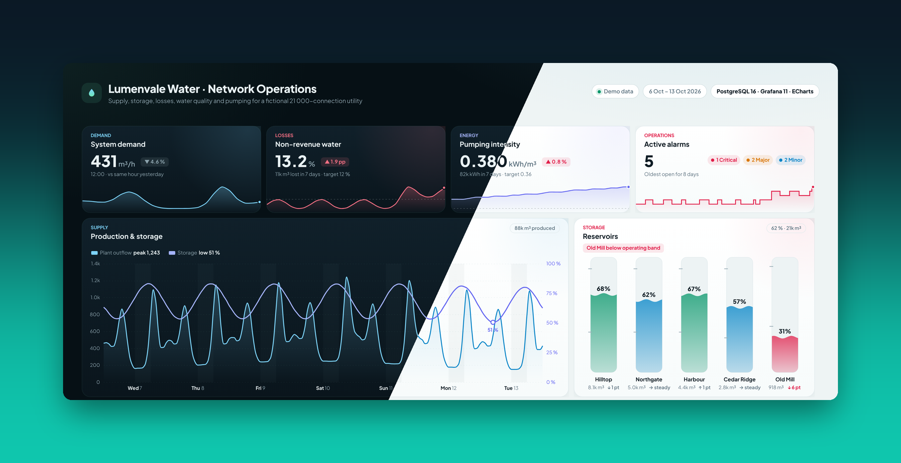
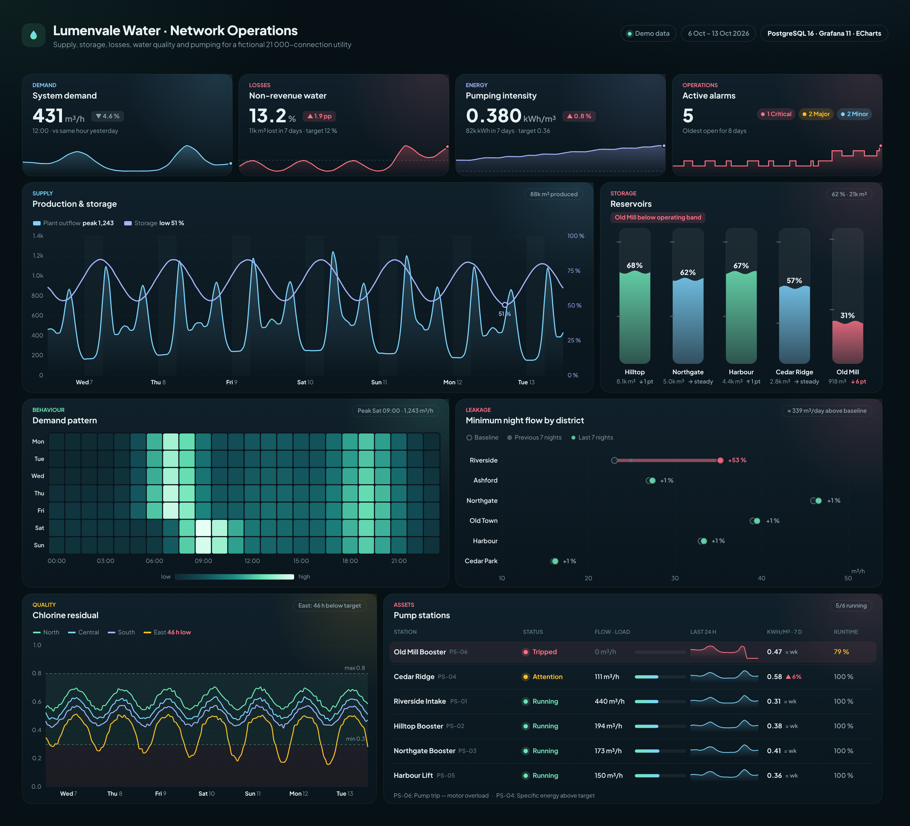
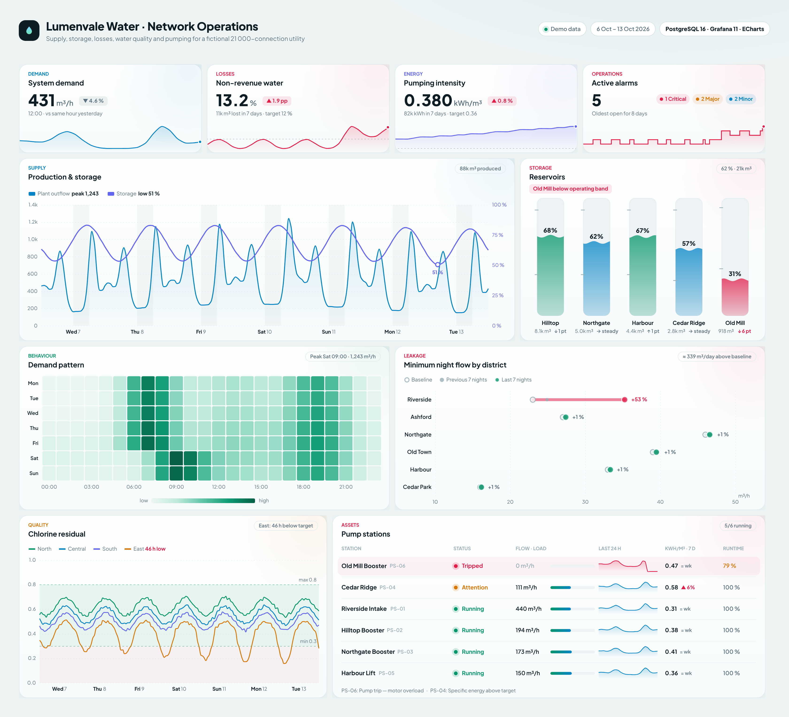

# Lumenvale Water · Network Operations

**An operations dashboard for a water utility, built with Grafana, Apache ECharts (via the Business Charts plugin)  and PostgreSQL.**
It covers supply, storage, losses, water quality and pumping on one screen, works in dark and light themes and adapts to any panel size.



> Lumenvale is a fictional town. Every asset, reading and alarm comes from the deterministic generator in [`db/02_seed.sql`](db/02_seed.sql), so the project needs no real data.

---

## What the dashboard answers

| Panel | Question it answers | How |
|---|---|---|
| **System demand** | How much water is the town using right now, compared with yesterday? | Latest hour vs the same hour 24 h earlier, with a 24 h sparkline |
| **Non-revenue water** | How much of the water we produce never gets billed? | System input vs smart-meter billing, volume-weighted over 7 days, against a 12 % target |
| **Pumping intensity** | Is pumping getting more expensive per m³? | kWh ÷ m³ per day across all stations, compared week on week |
| **Active alarms** | What needs attention, and how long has it been open? | Open alarms at the end of the range by severity, plus an hourly step trend |
| **Production & storage** | Is storage recovering every night? | Plant outflow (area) vs capacity-weighted storage (line), with night hours shaded |
| **Reservoirs** | Which tank is running low? | Custom tank glyphs: level, operating band, volume and 24 h change |
| **Demand pattern** | When are the peaks? | Weekday × hour heatmap |
| **Minimum night flow** | Where is the network leaking? | Dumbbell chart: each district's 02:00–04:00 flow vs its baseline, coloured by how far above baseline it is |
| **Chlorine residual** | Is disinfection within limits in every zone? | Hourly residual per zone against the 0.3–0.8 mg/l band, counting the hours below it |
| **Pump stations** | Are the pumps healthy and efficient? | Status, load, 24 h flow sparkline, kWh/m³ trend and runtime |

The seed data contains a few planted problems for the dashboard to surface. Riverside develops a leak, Old Mill reservoir drops below its operating band, a booster pump trips, and Cedar Ridge pump station slowly loses efficiency.

## Screenshots

| Dark | Light |
|---|---|
|  |  |

Each panel is also saved on its own in [`screenshots/panels/`](screenshots/panels).

## Run it

```bash
docker compose up
# open http://localhost:3000
```

This starts three containers:

- **PostgreSQL 16**, which loads the schema and about 100k rows of synthetic telemetry on its first start.
- **Grafana 11** with the [Business Charts](https://grafana.com/grafana/plugins/volkovlabs-echarts-panel/) plugin. The data source and dashboard are provisioned automatically, and anonymous viewing is on.
- **A refresher**, which calls `ops.shift_to_now()` every 15 minutes to move the data forward in time, so the dashboard keeps showing the last 7 days however long the stack runs.

## Data model

```
ops.sensor (tag, kind, unit, asset)  ──<  ops.reading (ts, sensor_id, value)   15-min historian
ops.reservoir · ops.dma · ops.pump_station                                      assets
ops.billed_daily (day, dma_id, billed_m3)                                       smart-meter billing
ops.alarm (raised_at, cleared_at, severity, asset_id, message)                  alarm log
```

The 21 000 connections are split across 6 districts. There are 5 reservoirs, 6 pump stations and 4 pressure zones. The data covers 35 days at 15-minute resolution, generated with `setseed`, so every run produces the same numbers.

## Design notes

- **Colour carries meaning.** Mint and sky are the signature colours. Coral appears only where someone needs to act (a leak, a trip, low storage) and amber means "watch". On cards where up is bad, such as NRW and kWh/m³, the delta chip turns coral when the number rises.
- **Left-aligned figures and full-bleed sparklines** keep the KPI cards readable at a glance and show the trend without taking up extra space.
- **Annotations come from the data**, for example "Peak Sat 09:00", "≈ 339 m³/day above baseline" and "East: 48 h below target", so the title row already gives the answer.

## Project layout

```
db/                 schema, seed, keep-fresh function
queries/            one .sql per panel (Grafana macros: $__timeFilter, $__timeTo…)
src/kit.js          design tokens, card, tooltip, formatting, resize hook
src/kpi.js          KPI card with delta chip + sparkline
src/panels/         one file per panel
dashboard.config.mjs  layout + which queries feed which panel
grafana/            provisioning + generated dashboard JSON
tools/              build, query runner, screenshot renderer, hero image
```

## License

MIT. The data is synthetic and the town is fictional.
